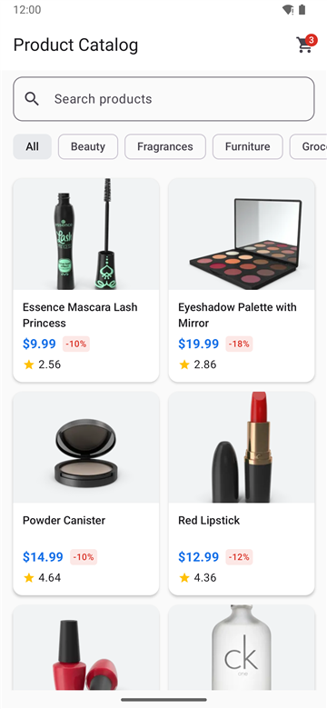
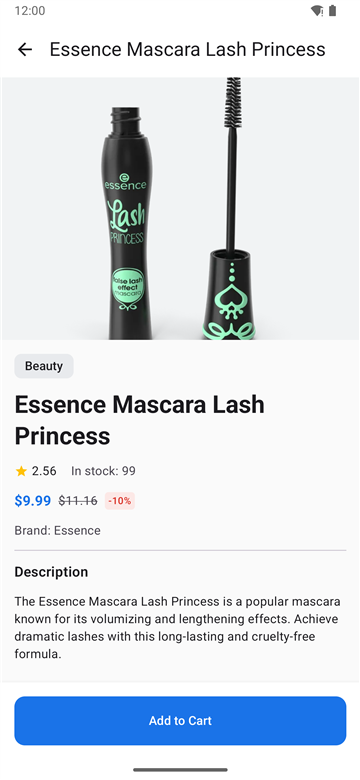
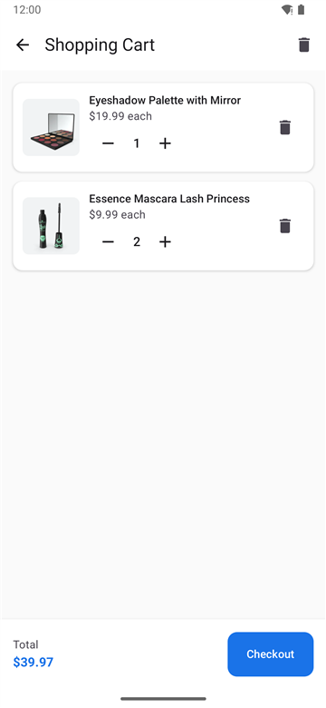
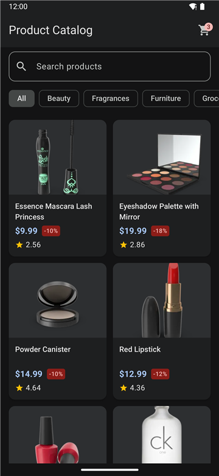

# Product Catalog

A 3-screen Android app built with Kotlin and Jetpack Compose on top of the public
[dummyjson.com](https://dummyjson.com) API. You can browse a paginated catalog, search and filter
it, open product details, and manage an in-memory shopping cart.

| Product list | Product detail | Cart | Dark theme |
|---|---|---|---|
|  |  |  |  |

---

## Required Android Studio version

⚠️ **Use Android Studio Panda 3 (2025.3.3 Patch 1) or newer.** Older versions, including Hedgehog,
will ask you to update before the project can sync.

The spec asks for two things that cannot both be true today:

- *"Build out-of-the-box on Android Studio **Hedgehog or newer**"*
- *"Target **latest stable**"*

According to Google's official compatibility pages:

| | Supports up to |
|---|---|
| Android Studio Hedgehog (2023.1.1) | AGP 8.2 ([table](https://developer.android.com/build/releases/about-agp)) |
| AGP 8.2 | API level 34 ([AGP 8.2 notes](https://developer.android.com/build/releases/past-releases/agp-8-2-0-release-notes)) |

The latest stable Android release is **Android 17 (API 37)**. Google's compatibility table lists
**AGP 9.1.1** and **Android Studio Panda 3 (2025.3.3 Patch 1)** as the minimum versions for API 37.

I read "Hedgehog or newer" as a minimum that was written when Hedgehog was current. Targeting the
latest stable SDK seemed more important than supporting a 2023 IDE, so the project uses the newer
toolchain. If Hedgehog support is required, the project can be moved to AGP 8.2 and SDK 34 with
matching older libraries. App code would barely change.

| Toolchain | Version |
|---|---|
| compileSdk / targetSdk | 37 |
| minSdk | 26 |
| Android Gradle Plugin | 9.1.1 (built-in Kotlin) |
| Gradle (wrapper) | 9.3.1 |
| Kotlin | 2.4.21 |
| JDK | 17+ (Android Studio's bundled JDK works) |

---

## Build & run

**Android Studio:** open the project folder, let Gradle sync, then run the `app` configuration on an
emulator or device (API 26+). If SDK Platform 37 is missing, Android Studio offers to install it.

**Command line:**

```bash
./gradlew assembleDebug        # build the debug APK
./gradlew testDebugUnitTest    # run the unit tests
./gradlew installDebug         # install on a connected device / emulator
```

No API keys or extra setup are needed.

---

## Features

**Product list**
- Top app bar with a cart badge showing the total number of units. The badge is hidden when the cart is empty.
- Search field with a magnifier and a clear button. Search is debounced (300 ms).
- Category chips loaded from `/products/categories`, starting with "All".
- A grid of product cards with at least two columns, and more on wide screens.
- Infinite scroll with `limit`/`skip`, with a spinner at the bottom while the next page loads.
- Loading, empty, and error states. The error state has Retry, failed categories and failed next pages
  have their own retry.
- Pull-to-refresh (also on the empty state).
- On short screens (e.g. a phone in landscape), the search field and chips share one row.

**Product detail**
- Top bar with the title (ellipsized) and a back arrow. Hero image 300dp tall.
- Category, title, rating, stock, price, the original price with strikethrough, the "-X%" tag, brand, and description.
- An "Add to Cart" button (56dp tall, 12dp corners) that shows a Snackbar with a **View cart** action.
- When stock is 0, "Out of stock" is shown in the error color and the button is disabled.
- Adding a product that is already in the cart increases its quantity instead of adding a second line.

**Cart**
- Item cards: 72dp thumbnail, title, unit price, a quantity stepper (− / value / +), and delete.
- Lowering the quantity below 1 removes the item. "+" stops at the product's stock.
- "Clear cart" asks for confirmation; the dialog survives rotation.
- Empty state.
- A sticky total with a Checkout button, which shows a Toast and empties the cart.
- Every change shows up on the list badge immediately.

---

## Architecture

MVVM with unidirectional data flow. Each screen has a ViewModel that exposes a `StateFlow<UiState>`
(the list screen also exposes its search text as Compose state; see below). Composables send events
up and render the state they receive.

```
UI (Compose)  ──events──▶  ViewModel  ──calls──▶  Repository  ──▶  Retrofit / in-memory cart
     ▲                         │
     └──── StateFlow<UiState> ─┘
```

```
com.bgvofir.productcatalog/
├── data/
│   ├── api/            ProductService (Retrofit), Product / ProductsResponse / Category
│   ├── DataState.kt    Loading / Success / Error(ErrorType)
│   └── CartItem.kt     cart line + totals
├── di/                 NetworkModule, RepositoryModule (Hilt)
├── repositories/       IProductRepository, ICartRepository + implementations
└── ui/
    ├── components/     ProductCard, DiscountTag, Rating, Loading/Error/Empty states
    ├── navigation/     type-safe routes + AppNavigation
    ├── preview/        sample data for Compose previews
    ├── screens/        productlist/, productdetail/, cart/  (Screen + ViewModel + UiState)
    └── theme/          light + dark color schemes, ProductCatalogTheme
```

**Key points**

- **Repository pattern.** ViewModels never call Retrofit directly. `ProductRepository` turns network,
  HTTP, and parsing failures into `DataState.Error(ErrorType)` and always rethrows
  `CancellationException`, so a cancelled screen never shows a stale result.
- **Errors are types, not text.** `ErrorType` (NETWORK / NOT_FOUND / SERVER) is mapped to string
  resources in the UI, so no user-facing text lives in the data layer.
- **One source of truth for the cart.** `CartRepository` is a Hilt `@Singleton` backed by a
  `MutableStateFlow`. Every change is atomic (`update {}`, or a single assignment for `clear()`), and
  every screen observes the same flow, which is how the cart screen updates the list badge.
- **One `Product` model** mirrors the JSON and is used by the list, detail, and cart, as the spec
  suggests. That's fine at this size; a larger app would map API DTOs to separate domain models.
- **Stateless screens.** Each screen is split into `XxxScreen` (connects to the ViewModel) and
  `XxxContent` (state in, callbacks out), which is what makes the previews possible.
- **Survives rotation and process death.** ViewModels survive rotation. The search query, category,
  and product id live in `SavedStateHandle`; products are simply re-fetched after process death.
  The text field reads a synchronous Compose `State`, because routing a `TextField` through a flow
  can drop characters.
- **Cancellation.** The first page, next pages, and refresh share one `Job`, so changing the filter
  cancels any request for the old filter and its results are never appended.
- **Navigation.** Type-safe `@Serializable` routes. Clicks are ignored while a screen is animating,
  so a double tap can't open a screen twice or pop past the first one.

### Libraries and why

| Concern | Choice | Why |
|---|---|---|
| UI | Jetpack Compose + Material 3 | As specified; all colors come from `MaterialTheme.colorScheme` roles |
| DI | Hilt | Checks the dependency graph at compile time; first-class ViewModel and Compose support |
| Network | Retrofit 3 + OkHttp | As specified; `suspend` functions are main-safe, so no dispatcher switching is needed |
| JSON | kotlinx-serialization | Kotlin-native and code-generated (no reflection); handles nullability and default values (e.g. a missing `brand`) correctly |
| Images | Coil 2 (`io.coil-kt:coil-compose`) | The artifact the spec names |
| Navigation | Navigation Compose 2.10, type-safe routes | Route arguments are checked by the compiler |
| Annotation processing | KSP | Faster than kapt, which is in maintenance mode |
| Tests | JUnit 4, kotlinx-coroutines-test, Turbine, MockWebServer | Virtual time for debounce tests; a real Retrofit stack against a fake server |

---

## Decisions on ambiguous parts of the spec

| Question | Decision | Reasoning |
|---|---|---|
| Can search and category be combined? | **No, they are mutually exclusive.** Typing resets the chip to "All"; picking a category clears the search. | The API has no endpoint for both. Combining them on the client would break paging (pages filtered locally could come back empty). |
| Are search and category results paged? | **Yes, all three sources use `limit`/`skip`.** | All three endpoints support it. |
| Can cart quantity go above stock? | **No.** "+" is disabled at the stock; adding again shows "All N in stock are already in your cart". | Selling more than you have is never right. |
| Must state survive process death, not just rotation? | **Yes**, for the query, category, and product id (`SavedStateHandle`). | Rotation is handled by the ViewModel itself. `SavedStateHandle` deliberately goes beyond the spec: the user's filter also survives Android killing the app in the background. Cheap to do. |
| What does Checkout do? | **Shows a Toast and empties the cart.** | The spec allows a no-op; emptying the cart makes the flow feel complete. |
| Should "Clear cart" ask first? | **Yes**, with a confirmation dialog. | It is destructive. |
| How does Detail get its product? | **It fetches `/products/{id}`** using the id from the route. | Works after process death, always shows fresh stock, and keeps screens independent. |
| What does the badge count? | **Total units** (2 mascaras + 1 palette = 3). | It matches what "items in cart" usually means in shops. |
| Android Studio Hedgehog vs. latest SDK | See [Required Android Studio version](#required-android-studio-version). | |

## Trade-offs

- **Prices are `Double`.** They come from the API that way and are only formatted for display. A
  real shop would use `BigDecimal` or integer cents to avoid rounding errors.
- **The cart lives in memory**, as the spec allows. It is cleared when the app process ends.
- **If a product's stock drops below the quantity already in the cart**, the quantity is kept and only
  "+" is blocked. Nothing is removed silently. (dummyjson stock never changes, so this can't happen
  with the real API.)
- **A failed pull-to-refresh shows the full-screen error with Retry**, the same as a failed first
  load, instead of keeping the old list and showing a snackbar. Simpler and consistent.
- **The "$X each" unit price in the cart is secondary text** on purpose, so it doesn't compete with
  the total, which uses the spec's price style.
- **The dark palette is derived.** Dark theme is a bonus item, but the spec only defines light
  colors, so the dark ones use the lighter tone of each spec blue and grey.
- **Interface names follow the spec** (`IProductRepository`) even though the `I` prefix is unusual in Kotlin.
- **Coil 2** is used because the spec names it; Coil 3 is the current major version.
- **`material-icons-extended`** is required by the spec but no longer maintained by Google.
- **Previews live in the main source set.** Only the annotations library is a runtime dependency (the
  rendering tools are `debugImplementation`), but with minification off the preview functions and
  sample data are compiled into the release APK, adding a few KB.

---

## Testing

**66 unit tests** (`./gradlew testDebugUnitTest`):

| Area | What is covered |
|---|---|
| Parsing | Real dummyjson JSON (including a product with no `brand`), discount math, the 100% edge case |
| Retrofit integration | MockWebServer: exact paths and query names, HTTP 404 → NOT_FOUND, malformed JSON → SERVER |
| ProductRepository | Error mapping, cancellation is rethrown, arguments are passed through |
| CartRepository | Adding increments instead of duplicating, stock cap, decrement-to-remove, totals, emissions (Turbine) |
| ProductListViewModel | 300 ms debounce, search/category exclusivity, paging for all three sources, cancelling a pending page on filter change, retries, pull-to-refresh, restore from `SavedStateHandle` |
| ProductDetailViewModel | Load by route id, NOT_FOUND, retry, add / limit reached / out of stock, snackbar message lifecycle |
| CartViewModel | Stepper totals, remove, clear, checkout, changes made on other screens |

Time-based logic runs on a virtual clock (`runTest`), so the debounce tests are instant and
deterministic. For tests that check cancellation, I confirmed they fail when the cancellation code is removed.

Also checked manually on an emulator against the live API: paging, debounce (one request for fast
typing), rotation (no refetch), a 360dp-wide screen (still two columns), dark mode, and the full cart flow.

---

## Bonus items

| Item | Status |
|---|---|
| Unit tests for ViewModels and repositories | ✅ |
| Compose previews / `@PreviewParameter` | ✅ the main states of each screen, light and dark (`@PreviewLightDark`) |
| Pull-to-refresh on the list | ✅ |
| Dark theme | ✅ |
| Animations | ✅ small ones: cart items animate when removed (`animateItem`) |
| Persist cart with DataStore / Room | ❌ see "With more time" |
| Multi-module | ❌ more boilerplate than benefit for 3 screens |
| Shared element transitions | ❌ |

## With more time

- **Persist the cart** with DataStore (or Room for larger data). This needs care so that an "add"
  made before the saved cart finishes loading doesn't overwrite it.
- **UI tests**: Compose UI tests for the main flows, plus screenshot tests (e.g. Roborazzi) built from
  the existing previews.
- **Keep the list on a failed refresh** and show a snackbar instead of the full-screen error.
- **Offline cache** of the last loaded products.
- **CI** (GitHub Actions running the build and tests on every push).
- **Money as `BigDecimal`/cents**, Coil 3, an accessibility pass with TalkBack, and shared element
  transitions from list to detail.

---

## How this was built

I used AI tools, as the ground rules allow. I implemented the app milestone by milestone with Claude
Code. Every milestone was then reviewed by two independent AI reviewers from different vendors (a
separate Claude agent and OpenAI Codex) against the spec and a written list of decisions. I fixed
every finding and repeated the reviews until both passed. The commits follow the milestones
(Milestone 1 has a follow-up commit for the AGP 9 / SDK 37 upgrade).
